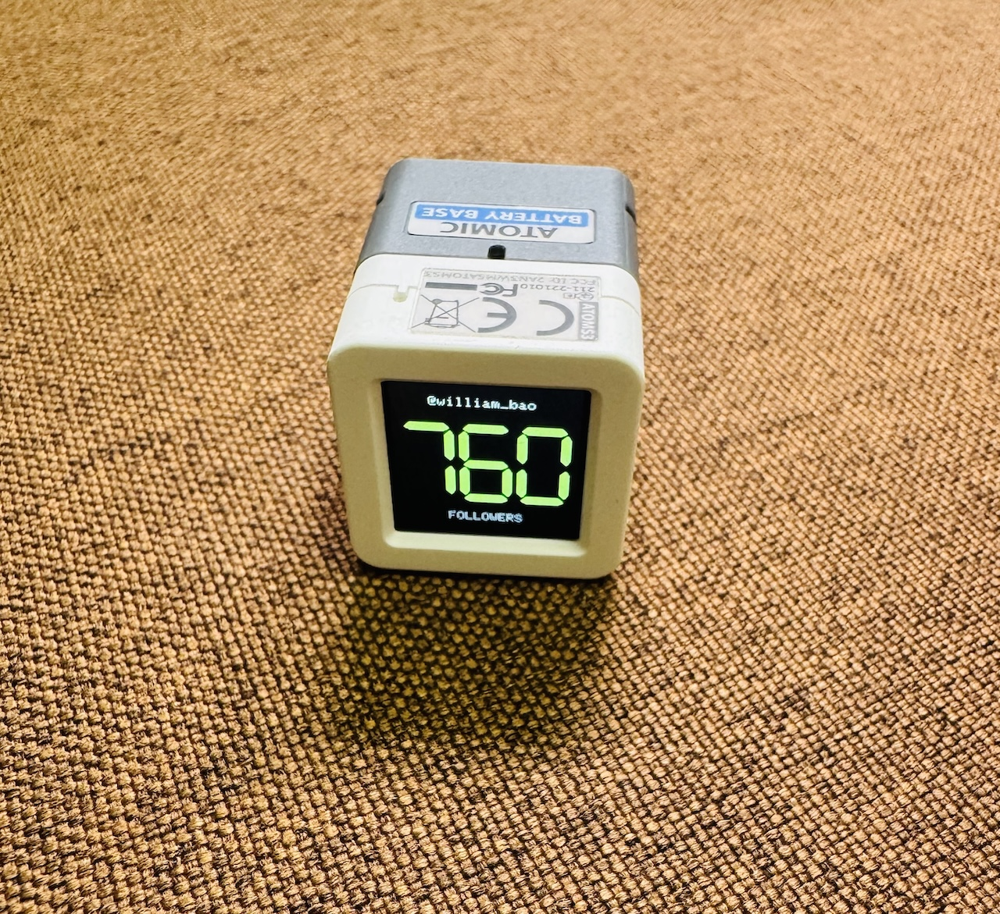

# AtomS3 X 粉丝计数器

一个运行在 **M5Stack AtomS3** 上的独立 X（Twitter）粉丝计数器。亮绿色七段数字突出显示粉丝数，内置 IMU 自动调整屏幕方向。

[English](README.md) | 简体中文

<p align="center">
  
</p>

通过 USB 串口配置账号和 Wi-Fi 后，接通电源即可独立运行，无需配套应用、持续运行的电脑或自行申请 API Key。

## 功能

- **直接获取数据**：通过 HTTPS 请求 FxEmbed / FxTwitter 账号接口。
- **自动与手动刷新**：启动联网后刷新，默认每五分钟更新，也可按正面按钮手动刷新。
- **清晰的七段数字**：使用整数像素绘制，支持自定义颜色和亮度。
- **数字自适应**：五位数及以内显示完整整数，更大的数字使用两位小数和 `K`、`M`、`B` 等单位。
- **IMU 自动旋转**：支持四个方向，方向稳定 600ms 后切换，平放或晃动时避免误转。
- **配置持久保存**：Wi-Fi、账号、更新频率、颜色、亮度和旋转设置保存到 NVS，重启后保留。
- **失败恢复**：自动重连 Wi-Fi，临时错误逐步退避重试，遵守限流等待，并在运行期间保留最后一次有效粉丝数。

## 硬件

本项目适用于原版 **[M5Stack AtomS3](https://docs.m5stack.com/zh_CN/core/AtomS3)**，型号 **C123**：

- ESP32-S3，8 MB Flash
- 128 × 128 显示屏
- MPU6886 IMU
- 正面可编程按钮，USB-C 供电及烧录

AtomS3 Lite 和 AtomS3R 不属于本项目已测试的目标。请使用支持数据传输的 USB 线，以及 **2.4 GHz Wi-Fi 网络**。

## 编译与烧录

安装 [PlatformIO](https://platformio.org/)，然后克隆仓库：

```sh
git clone https://github.com/williambao/atoms3-x-followers.git
cd atoms3-x-followers
pio run -e atoms3
pio device list
```

将以下命令中的 `YOUR_PORT` 替换为 PlatformIO 列出的串口，例如 macOS 的 `/dev/cu.usbmodem1101`、Linux 的 `/dev/ttyACM0` 或 Windows 的 `COM3`：

```sh
pio run -e atoms3 -t upload --upload-port YOUR_PORT
pio device monitor --port YOUR_PORT --baud 115200
```

烧录前关闭其他占用串口的监视器。烧录会替换设备当前固件。如果无法自动进入下载模式，请按 [AtomS3 官方说明](https://docs.m5stack.com/zh_CN/core/AtomS3) 长按背面复位按钮约两秒，内部绿色 LED 亮起后松开，再次烧录。

项目使用 Arduino 框架，标准 C++ 入口位于 [`src/main.cpp`](src/main.cpp)，不使用 `.ino` 文件。[`platformio.ini`](platformio.ini) 固定了开发平台和依赖版本：

| 依赖 | 版本 |
| --- | --- |
| pioarduino ESP32 platform | 55.03.38 |
| Arduino-ESP32 | 3.3.8 |
| M5Unified | 0.2.19 |
| M5GFX | 0.2.26 |
| ArduinoJson | 7.4.3 |

首次编译需要下载依赖。M5GFX 从官方 Git 标签的源码归档获取。

## 首次配置

首次启动时没有配置 Wi-Fi 或账号。屏幕先显示 `SET WIFI`；设置 Wi-Fi 后，如果账号仍为空，则显示 `SET ACCOUNT`。

以 **115200 波特率**打开串口监视器，将下面的占位值替换成自己的配置，作为**单独一行**发送，并以换行结束：

```json
{"cmd":"set","wifi":{"ssid":"YOUR_WIFI_SSID","password":"YOUR_WIFI_PASSWORD"},"account":"your_handle"}
```

修改成功后返回：

```json
{"cmd":"set","ok":true,"changed":true,"saved":true}
```

设备连接 Wi-Fi、通过 NTP 校时后，会自动查询粉丝数。网络需要能够访问 `api.fxtwitter.com` 的 HTTPS 服务及 NTP 时间服务器；电脑的代理设置不会自动应用到开发板。

设置保存到 **NVS**，重启后自动加载，不需要将 Wi-Fi 凭据编译进固件。粉丝数本身保存在内存中，重启后重新查询。

## 显示与操作

按**正面按钮**请求刷新；**背面按钮**用于复位和进入下载模式。

正常界面只显示账号、大号粉丝数和小号 `FOLLOWERS` 标签。刷新时使用小型指示动画，错误时显示简短提示。查询失败不会将有效数字替换成错误的零粉丝。

| 粉丝数 | 屏幕显示 |
| --- | --- |
| `749` | `749` |
| `12345` | `12345` |
| `99999` | `99999` |
| `100000` | `100.00K` |
| `1234567` | `1.23M` |
| `1000000000` | `1.00B` |

四舍五入达到下一单位时自动进位，例如 `999995` 显示为 `1.00M`。数字、小数点和小号单位标签的组合宽度不超过 116 像素。串口始终返回完整整数，显示缩写不会改变原始数据。

自动旋转默认开启。新方向稳定 600ms 后才切换；平放、接近对角线或明显晃动时保持上一次方向。自动检测到的角度不会反复写入 Flash。

固定显示方向：

```json
{"cmd":"set","auto_rotation":false,"rotation":90}
```

重新开启自动旋转：

```json
{"cmd":"set","auto_rotation":true}
```

保存的 `rotation` 是手动方向，也是 IMU 不可用时的启动备用方向。IMU 不可用不会阻止粉丝数更新。

## 串口协议

**每行发送一个 JSON 对象**，支持 LF 或 CRLF。单条命令最长 **1024 字节**，不含换行符。

- `cmd` 必填，区分大小写。
- `id` 可选；传入时响应原样回传，不传入时响应也不包含它。
- 异步通知使用 `event` 字段，与命令响应区分。

| 命令 | 用途 |
| --- | --- |
| `set` | 校验、保存并应用部分配置更新 |
| `get` | 读取配置，不返回 Wi-Fi 密码 |
| `status` | 读取连接、粉丝数、错误及 IMU 状态 |
| `refresh` | 请求一次手动刷新 |
| `help` | 查看协议摘要 |

### 配置参数

**`set` 中的所有配置字段都可选。没有传入的字段保持原值，包括 `wifi` 对象内部的各个字段。** 程序先校验所有传入字段，再保存和应用；无效值、未知字段或 `null` 会让整条更新失败。

| 字段 | 可接受的值 | 出厂默认值 |
| --- | --- | --- |
| `wifi.ssid` | 字符串，最多 32 字节；`""` 清除 SSID | 空 |
| `wifi.password` | 8～63 字节密码、64 位十六进制 PSK，或表示开放网络的 `""` | 空 |
| `account` | 1～15 个英文字母、数字或下划线；允许前置 `@`；`""` 清除账号 | 空 |
| `interval_sec` | 60～86400 之间的整数 | `300` |
| `number_color` | 十六进制字符串 `"#RRGGBB"`，大小写均可 | `"#A8FF60"` |
| `brightness` | 1～255 之间的整数 | `160` |
| `auto_rotation` | 布尔值 | `true` |
| `rotation` | `0`、`90`、`180` 或 `270` 度 | `0` |

例如，只修改颜色不会改变网络、账号或其他设置：

```json
{"cmd":"set","number_color":"#FFBE55"}
```

其他可独立发送的示例：

```json
{"cmd":"set","interval_sec":600,"brightness":120}
{"cmd":"set","wifi":{"password":"another-password"}}
{"cmd":"set","account":"@your_handle"}
```

修改 SSID 而没有传入密码时，会保留旧密码；切换到开放网络时需显式设置 `"password":""`。`{"cmd":"set"}` 和 `{"cmd":"set","wifi":{}}` 都是成功但不修改配置的操作。

配置先作为单个 NVS 记录保存，成功后再应用。同样的设置不会重复写入 Flash。已有保存配置会覆盖 [`include/FollowerCore.h`](include/FollowerCore.h) 中的出厂默认值。

`get` 返回 SSID 和 `password_set` 标记，不返回密码。本固件没有额外启用 NVS 加密。

### 状态与刷新

```json
{"cmd":"get"}
{"cmd":"status","id":7}
{"cmd":"refresh"}
```

`status` 包含 `state`、`wifi_connected`、`clock_synced`、`followers`、`stale`、`http_status`、`data_source`、`auto_rotation`、`effective_rotation` 和 `imu_available` 等字段。IMU 可用时，`accel_g` 包含加速度读数。尚无有效粉丝数时，`followers` 为 `null`。

刷新确认只表示已接受请求，不代表网络查询已经成功：

```json
{"cmd":"refresh","ok":true,"state":"queued"}
```

查询完成后另发事件，例如：

```json
{"event":"refresh","account":"your_handle","cause":"serial","ok":true,"http_status":200,"stale":false,"followers":12345}
```

同一时间只执行一个查询。每次查询开始后有五秒手动刷新冷却；正在查询时再请求会返回 `busy`。按按钮或发送 `refresh` 都不会绕过服务端要求的等待时间。

## 故障排查

| 屏幕提示 | 含义与处理 |
| --- | --- |
| `SET WIFI` / `SET ACCOUNT` | 使用 `set` 补充缺失配置。 |
| `CONNECTING` / `WIFI OFFLINE` | 检查 SSID、密码和 2.4 GHz 信号。连接尝试 20 秒超时后会自动重试。 |
| `SYNC TIME` / `TIME ERROR` | NTP 校时尚未完成或超时。TLS 证书验证需要有效时间。 |
| `TIMEOUT` / `API ERROR` | 请求、TLS 连接或上游服务失败。使用 `status` 查看详情。 |
| `BAD DATA` | 返回内容无法校验为指定账号资料及整数粉丝数。 |
| `RATE LIMITED` | 等待服务端指定的重试窗口。 |
| `NO PROFILE` | 数据源无法提供该账号资料，或未找到账号。 |
| `STALE DATA` | 距上次成功查询已超过十分钟与两倍刷新间隔中的较大值。 |
| `CONFIG ERROR` | 保存记录无法加载，使用 `set` 写入有效配置。 |
| `STORAGE ERROR` / `SYSTEM ERROR` | 存储初始化或资源分配失败，查看串口输出。 |

临时查询失败后，重试间隔按 15、30、60、120、240 秒逐步延长，最长 300 秒。不可直接恢复的错误会暂停自动查询；修改账号或网络配置、手动刷新或网络恢复后可以再次尝试。账号资料暂时不可用时，按不快于配置更新间隔的频率重试，避免临时 404 导致监控永久暂停。固件运行期间会保留已有的有效粉丝数。

如果烧录提示串口被占用，请关闭持有连接的程序。有些串口工具在建立连接时会复位设备，已保存的配置不会因此丢失。

## 数据源

固件使用公开的 [FxEmbed 账号接口](https://docs.fxembed.com/api/twitter/operations/2profilehandle/)：

```text
GET https://api.fxtwitter.com/2/profile/{account}
```

程序校验接口结果码、资料类型、账号名称和 `user.followers`。HTTPS 使用 ESP32 CA 证书包验证证书。本固件不使用 X 登录 Cookie，也不存储 X API 令牌。

FxEmbed 是第三方服务，其可用性和上游缓存不受本项目控制。接口没有提供此次数据的采集时间，因此设备刷新成功不等于 X 刚刚更新了数据。`last_success_age_sec` 仅表示设备距上次成功请求的时间。

## 测试

在 macOS 或 Linux 上，主机测试需要 Python 3、支持 AddressSanitizer/UndefinedBehaviorSanitizer 的 C++17 编译器，以及 ArduinoJson 7 头文件：

```sh
python3 tests/run_tests.py --arduinojson /path/to/ArduinoJson
```

传入包含 `src` 目录的 ArduinoJson 库根目录。通过 PlatformIO 安装依赖后，通常位于 `.pio/libdeps/atoms3/ArduinoJson`。

三个测试套件覆盖部分配置更新与持久化序列化、使用硬件替身运行的实际主程序、数字布局与格式化，以及旋转过滤。硬件替身不能证明真实 Wi-Fi、屏幕或 NVS 的运行行为。

在真实 AtomS3 上，还应检查 Wi-Fi 配置、HTTPS 查询、按钮及定时刷新、重启后配置保留，以及四个方向的屏幕旋转。

## 许可证

[Apache License 2.0](LICENSE)。
